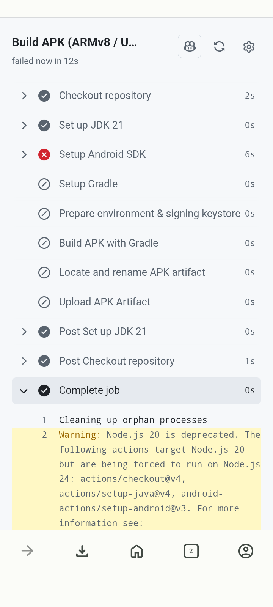
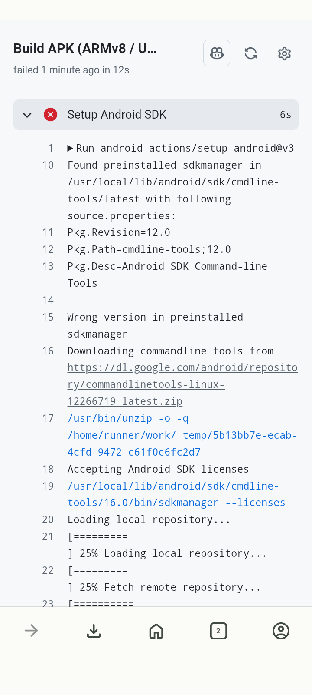
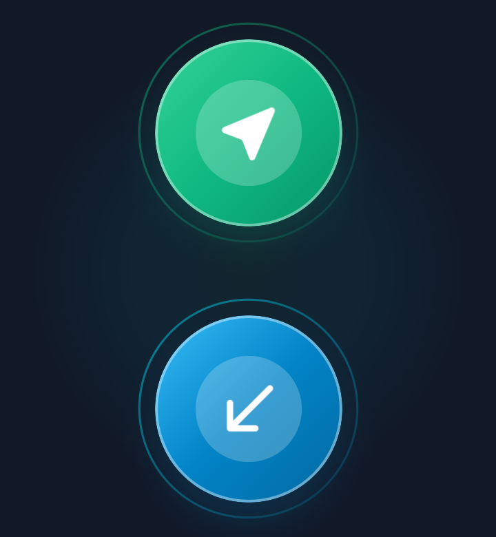
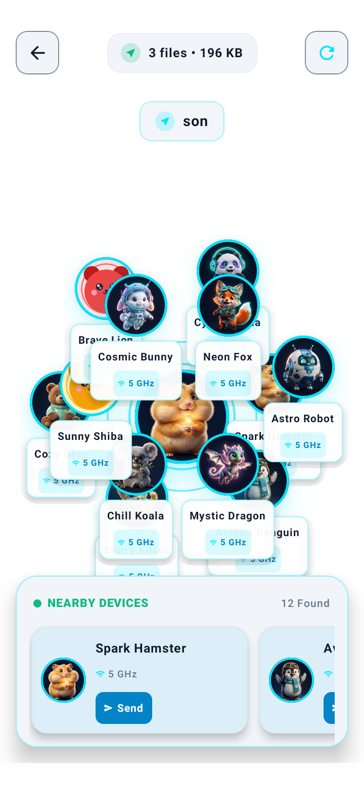

# Cute Share

<p align="center">
  
</p>

<p align="center">
  Share files with nearby devices in a cute, simple way.
</p>

| App details | Information |
| --- | --- |
| **Version** | 1.0 |
| **Developer** | [Vilson Sonkar](https://github.com/Vilson1999) |
| **App language** | English |
| **Platform** | Android 9 (API 28) and later |
| **Built with** | Kotlin, Jetpack Compose |

Cute Share is an Android app for discovering nearby devices and transferring files directly between them.

## Screenshots

<p align="center">
  &nbsp;
  &nbsp;
  &nbsp;
  
</p>

## Features

### Home & quick actions

- Start a file send or open the receive screen from the home screen.
- Create a profile with a display name and a cute avatar.
- Choose from a collection of illustrated avatars.
- Use light, dark, or system theme mode.

### Browse and choose files

- Browse files on the device or open the system file picker.
- Find and select images, videos, audio, apps, documents, archives, and other storage files.
- Share files selected through Android's share menu.
- Select files before choosing a nearby recipient.

### Send files to a nearby device

- Discover nearby devices that are ready to receive.
- Send selected files directly to a chosen peer.
- See the selected file count and total size while preparing a transfer.
- Use Wi-Fi and nearby-device connectivity for peer-to-peer sharing.

### Receive files

- Open the receive screen so a sender can find your device.
- See when the app is waiting for a sender.
- Rescan for a sender when needed.
- Save received files to device storage.

### Transfer management

- View transfer progress and session details in the transfer screen.
- Keep a transfer history in the app.
- Handle incoming transfer requests.
- Add more files to an active transfer session.

## Download

Prebuilt APKs are available in [`public/`](public/):

- [Universal APK](public/CuteShare.apk)
- [ARM64-v8a APK](public/CuteShare-arm64-v8a.apk)
- [ARMv7 APK](public/CuteShare-armeabi-v7a.apk)

## Build from source

1. Clone this repository.
2. Open it in Android Studio or use the Gradle wrapper.
3. Build the debug APK:

   ```bash
   ./gradlew assembleDebug
   ```

The app's minimum Android version is API 28 (Android 9).
